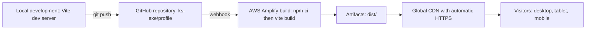
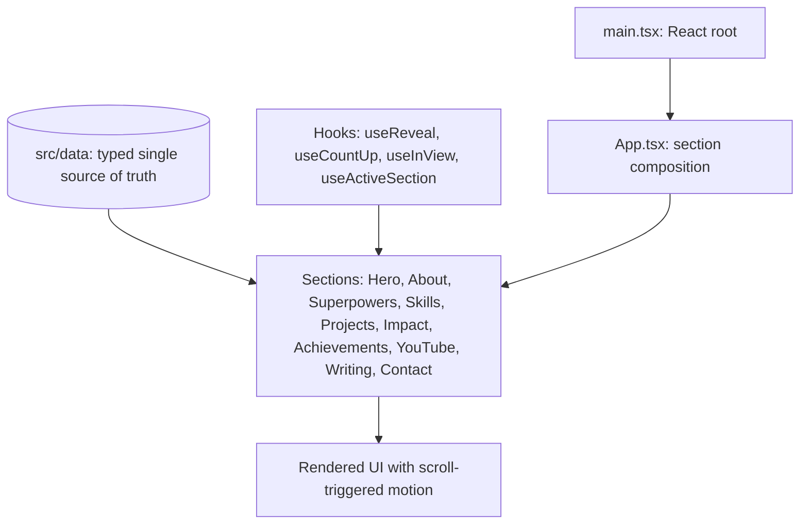
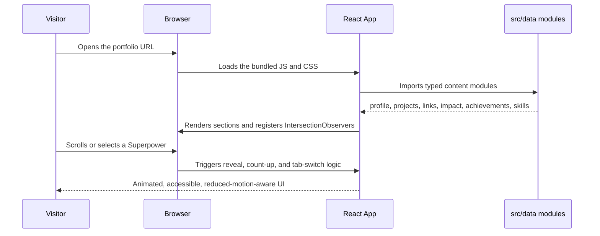

# Khadija Sajid — Engineering Portfolio

**I build intelligent systems. Not just software.**


A single-page personal portfolio for an AI and Data Engineer, built with React,
TypeScript, and Tailwind CSS, and deployed on AWS Amplify Hosting with continuous
deployment from the `main` branch. The site presents real engineering work, a
verified community-leadership record, and an interactive feature, all driven by a
typed, single-source-of-truth data layer.

**Live site: https://main.d1d0tpxe1gf39f.amplifyapp.com/**

[Overview](#overview) · [Architecture](#architecture) · [Tech stack](#tech-stack) ·
[Project structure](#project-structure) · [Quick start](#quick-start) ·
[Deployment](#deployment-aws-amplify) · [Featured work](#featured-engineering-work) ·
[Engineering notes](#engineering-notes) · [Contact](#contact)

## Overview

This repository is both a personal portfolio and a demonstration of how I build
software: clean architecture, a disciplined design system, type-safe code, honest
content, and a production deployment with automated CI/CD.

The design direction is deliberately distinctive — an editorial aesthetic
(oxblood, parchment, and ink) that reads like an independent technology
publication rather than a generic developer template. Content is never
fabricated: links that are not yet available are marked, not invented, and no
metrics, screenshots, or credentials are faked.

| | |
| --- | --- |
| Role | AI and Data Engineer |
| Location | Pakistan |
| Focus | AI Engineering, Data Engineering, AWS and Cloud |
| Availability | Open to AI Engineering, Data Engineering, and Cloud opportunities |
| Institution | COMSATS University Islamabad, Sahiwal Campus (final year, Computer Science) |

## What it does

| Area | Implemented behavior |
| --- | --- |
| Presents engineering work | Seven real projects with verified GitHub, live-demo, and walkthrough links. |
| Tells a professional story | Editorial hero, about, and principles sections built from a typed profile module. |
| Provides an interactive feature | A "Three sides, one engineer" experience (Builder, Leader, Enabler) with accessible tab semantics. |
| Documents community impact | AWS Student Builder Group leadership metrics and a journey timeline. |
| Lists capabilities honestly | Skill groups with no fabricated proficiency scores; credentials flagged when unverified. |
| Ships to production | AWS Amplify Hosting with build, artifact, and global CDN delivery on every push. |

The animation system (cinematic hero, scroll reveals, count-up statistics, hover
states) is hand-built with CSS keyframes, SVG, and IntersectionObserver — no heavy
animation dependency — and respects `prefers-reduced-motion` throughout.

## Architecture

### Deployment and CI/CD



Local mode: Vite dev server with hot module replacement.
AWS hosting: Amplify runs the build from `amplify.yml`, publishes the `dist/`
artifacts to a CloudFront-backed CDN, and serves the site over HTTPS. Each push to
`main` triggers an automatic rebuild and redeploy.

### Frontend application



The `src/data` modules are the single source of truth. Components are thin,
presentational, and read their content from typed data, which keeps the site
maintainable and prevents unverified information from entering the UI.

### Content data flow



## Tech stack

| Layer | Technology | Rationale |
| --- | --- | --- |
| Framework | React 18 with TypeScript 5 | Type-safe, component-driven, widely adopted. |
| Build tool | Vite 6 | Fast hot reload and optimized production bundles. |
| Styling | Tailwind CSS 3 | Utility-first styling over a custom editorial token set. |
| Icons | Lucide React | Consistent, tree-shakeable icon set. |
| Animation | CSS keyframes, SVG, IntersectionObserver | No heavy animation library; GPU-friendly and mobile-safe. |
| Hosting | AWS Amplify Hosting | Continuous deployment, global CDN, automatic HTTPS. |
| Source control | Git and GitHub | Triggers the Amplify deployment on push. |

### Design tokens

| Token | Value | Usage |
| --- | --- | --- |
| Oxblood | `#762B3B` | Primary brand accent. |
| Deep oxblood | `#4D202C` | Hover and depth. |
| Parchment | `#F2EDE4` | Light section background. |
| Warm paper | `#FBF9F5` | Primary background. |
| Ink | `#201C1B` | Dark sections and primary text. |

Typography: Playfair Display for display headings, Manrope for body text, and
IBM Plex Mono for technical labels.

## Project structure

```text
public/                 Static assets (favicon, profile image)
src/
  components/           Reusable UI: Navigation, Footer, BackToTop, ProjectVisuals
  sections/             Page sections (Hero, About, Superpowers, Projects, ...)
  data/                 Typed single source of truth
    profile.ts          Identity, headline, biography, principles
    projects.ts         Seven projects, ordered, with featured flags
    links.ts            Verified social and contact URLs
    impact.ts           Community statistics and timeline
    achievements.ts     Credentials, with unverified items flagged
    skills.ts           Capability groups
    nav.ts              Navigation items
  hooks/                useReveal, useCountUp, useInView, useActiveSection
  App.tsx               Section composition
  main.tsx              React entry point
  index.css             Design tokens and animation system
amplify.yml             AWS Amplify build specification
tailwind.config.js      Custom theme and keyframes
vite.config.ts          Vite configuration
tsconfig.json           TypeScript configuration
```

## Quick start

Use Node.js 18 or later and npm 10 or later.

### 1. Install

```bash
git clone https://github.com/ks-exe/profile.git
cd profile
npm install
```

### 2. Run the development server

```bash
npm run dev
```

The dev server prints a local address (default http://localhost:5173).

### 3. Type-check and build

```bash
npm run lint     # tsc --noEmit
npm run build    # tsc --noEmit, then vite build into dist/
npm run preview  # serve the production build locally
```

| Command | Purpose |
| --- | --- |
| `npm run dev` | Start the Vite development server with hot reload. |
| `npm run lint` | Run the TypeScript compiler in no-emit mode. |
| `npm run build` | Type-check and produce the optimized production bundle in `dist/`. |
| `npm run preview` | Preview the production build locally. |

## Deployment (AWS Amplify)

The project is configured for continuous deployment through `amplify.yml`:

```yaml
version: 1
frontend:
  phases:
    preBuild:
      commands:
        - npm ci
    build:
      commands:
        - npm run build
  artifacts:
    baseDirectory: dist
    files:
      - '**/*'
  cache:
    paths:
      - node_modules/**/*
```

To deploy a copy:

1. Push the repository to GitHub.
2. In the AWS Amplify Console, choose **New app**, then **Host web app**, and
   connect the GitHub repository.
3. Amplify detects `amplify.yml` automatically (build command `npm ci` then
   `npm run build`, output directory `dist`).
4. Choose **Save and deploy**. Amplify provisions an HTTPS URL and redeploys on
   every push to the connected branch.

This site is deployed at https://main.d1d0tpxe1gf39f.amplifyapp.com/.

## Featured engineering work

The projects below are showcased in the portfolio. Order is intentional; all
links are verified.

| # | Project | Domain | Links |
| --- | --- | --- | --- |
| 01 | AI Data Pipeline Generator | AI, Data Engineering, AWS | [Code](https://github.com/ks-exe/AI-data-Pipeline-generator) · [Live demo](https://dev.d273q6bevgfbgl.amplifyapp.com) |
| 02 | AI-Powered Security Incident Analytics Platform | Data Engineering, AI analytics | [Code](https://github.com/ks-exe/AI-Powered-Security-Incident-Analytics-Platform) |
| 03 | EcoProof — Climate Data and Environmental Monitoring | Data Engineering, Web3 | [Code](https://github.com/ks-exe/EcoProof_Climate-Data-Environmental-Monitoring) · [Video](https://youtu.be/mIxmj9SkpQ0) |
| 04 | Project Ullo — AI Incident Triage for Data Pipelines | Agentic AI, DataOps | [Code](https://github.com/ks-exe/project-ullo) · [Walkthrough](https://youtu.be/L49PCaaJgPQ) |
| 05 | Amazon Bedrock AgentCore Harness | Amazon Bedrock, AgentCore | [Code](https://github.com/ks-exe/Amazon-Bedrock-Agentcore-Harness) |
| 06 | Data Quality Inspector | AI, Data Engineering, AWS | [Code](https://github.com/ks-exe/Data-Quality-Inspector) · [Live demo](https://u97j0opdi9.execute-api.us-east-2.amazonaws.com) · [Video](https://youtu.be/zZUFQLpvs8A) |
| 07 | NeuroPath AI (AWS 10,000 AIdeas Top 50 Finalist) | AI, Intelligent Learning | [Code](https://github.com/ks-exe/Neuro-Path-AI) · [Video](https://youtu.be/LGUcXuvvigM) |

## Community leadership and impact

As AWS Student Builder Group Lead at COMSATS Sahiwal:

| Metric | Value |
| --- | --- |
| AWS-focused events in eight months | 15 |
| Average event attendance | 90+ |
| Combined community members and followers | 3,000+ |
| Registrations in one week for AWS Student Community Day Sahiwal 2026 | 1,000+ |
| Attendees at the event | 500+ |
| Girls mentored in person | 170+ |

The goal has stayed the same from a small group of learners to a growing AWS
community: create opportunities for students to learn by building.

## Portfolio sections

| Section | Summary |
| --- | --- |
| Hero | Animated data-flow illustration (ingest, process, AI/LLM, AWS), parallax, cinematic entrance. |
| About | Editorial two-column story and operating principles. |
| Superpowers | Interactive Builder, Leader, and Enabler feature with accessible tabs. |
| Skills | Capability groups across AI/ML, Data Engineering, AWS and Cloud, and DevOps. |
| Projects | Seven projects with per-type animated visualizations and verified links. |
| Impact | Community metrics that count up on view, plus a journey timeline. |
| Achievements | Certifications and recognition, with unverified items flagged. |
| Writing and videos | Knowledge-sharing channels and project walkthroughs. |
| Contact | Copy-to-clipboard email, verified channels, and an identity summary. |

## Technologies referenced

Frontend and tooling: React, TypeScript, Vite, Tailwind CSS, Lucide, Git and GitHub.

AWS hosting: AWS Amplify Hosting (continuous deployment, CDN, HTTPS).

AWS across the featured projects: Amazon Bedrock, AWS Lambda, Amazon API Gateway,
Amazon DynamoDB, Amazon S3, AWS CDK, Amplify Gen 2, AgentCore, and Bedrock Flows
and Evaluations.

Data engineering across the featured projects: dlt, dbt, Dagster, DuckDB, Apache
Iceberg, PostgreSQL, Cube.js, Apache Superset, and scikit-learn.

## Engineering notes

- Content is modeled as typed data. Centralizing everything in `src/data` with
  explicit TypeScript types keeps components clean and prevents unverified links
  or metrics from entering the UI.
- The interactive feature uses real tab semantics (`role="tab"`), keyboard
  support, and a key-based remount for smooth transitions, with reduced-motion
  fallbacks.
- The motion system is built without a heavy animation library, which keeps the
  bundle small and performance strong on mobile and low-powered devices.
- The site is deployed to AWS Amplify with CI/CD rather than demonstrated only on
  localhost, reflecting a production-first workflow.

## Accessibility and quality

- Semantic HTML with a correct heading hierarchy.
- Keyboard-accessible interactions and visible focus states.
- Reduced-motion support across all animations.
- Responsive layouts for desktop, tablet, and mobile with no horizontal overflow.
- TypeScript strict mode with zero type errors and a clean production build.

## Contact

Open to AI Engineering, Data Engineering, and Cloud opportunities.

| Channel | Link |
| --- | --- |
| Email | khadijasajid280@gmail.com |
| LinkedIn | https://www.linkedin.com/in/khadija-sajid-267091266/ |
| GitHub | https://github.com/ks-exe |
| YouTube | https://www.youtube.com/@KhadijaSajid-Tech |
| AWS Builder Center | https://builder.aws.com/profile?tab=badges |

Designed and engineered by Khadija Sajid. 2026, Pakistan.
