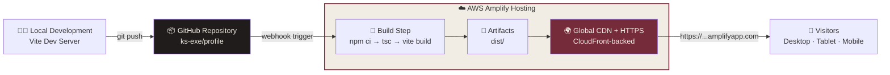
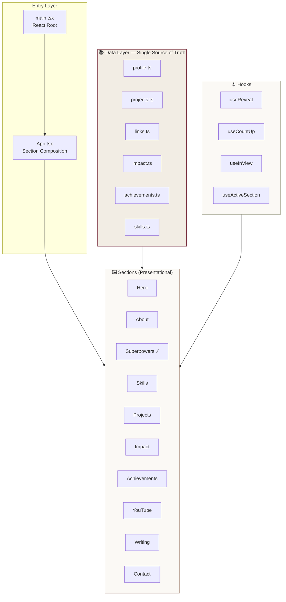
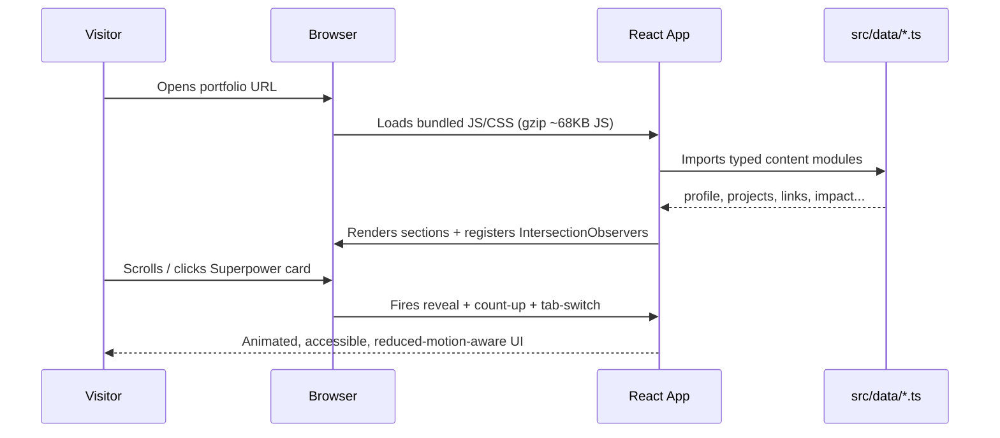

<div align="center">

# Khadija Sajid — Engineering Portfolio

### I build intelligent systems. Not just software.

**AI &amp; Data Engineer · Cloud &amp; AWS Builder · Community Leader**

A premium, editorial-style personal portfolio engineered with React, TypeScript, and Tailwind CSS, deployed on AWS Amplify Hosting with a fully automated CI/CD pipeline.

<br/>

[](https://main.d1d0tpxe1gf39f.amplifyapp.com/)
[](https://www.linkedin.com/in/khadija-sajid-267091266/)
[](https://github.com/ks-exe)
[](https://www.youtube.com/@KhadijaSajid-Tech)

<br/>


</div>

---

## 🔗 Live Deployment

> ### **https://main.d1d0tpxe1gf39f.amplifyapp.com/**
>
> Hosted on **AWS Amplify Hosting** · Global CDN · Automatic HTTPS · Continuous deployment from `main`

Every push to the `main` branch triggers an automatic build and global redeploy. No manual steps, no downtime.

---

## �‍💻 About the Engineer

I'm a final-year Computer Science undergraduate at **COMSATS University Islamabad, Sahiwal Campus**, focused on **AI Engineering, Data Engineering, and cloud technologies**. I build practical systems that solve real problems — from AI-assisted data quality analysis to agentic DataOps pipelines — and I lead the **AWS Student Builder Group** at my campus, where I've helped a growing community of students learn by building.

This repository is both my **personal portfolio** and a **demonstration of how I engineer software**: clean architecture, a disciplined design system, type-safe code, honest content, and production-grade deployment.

| | |
|---|---|
| **Role** | AI &amp; Data Engineer |
| **Location** | Pakistan |
| **Focus** | AI Engineering · Data Engineering · AWS &amp; Cloud |
| **Availability** | Open to AI Engineering, Data Engineering and Cloud opportunities |
| **Mission** | Build. Engineer. Enable. |

---

## ✨ Why This Portfolio Stands Out

This isn't a template. Every decision was made deliberately:

- **🎨 Distinctive visual identity** — an *Editorial Brutalism × Engineering Journal* aesthetic (oxblood, parchment, ink) that reads like an independent tech publication, not a generic developer template.
- **🧩 A real interactive feature** — the *"Three Sides. One Engineer."* experience lets visitors unlock three facets of my work (Builder / Leader / Enabler) through genuine, accessible tab interactions.
- **🎬 A cohesive motion system** — cinematic hero (animated data-flow SVG, shooting stars, parallax), scroll-reveal choreography, count-up statistics, and refined hover states — all respecting `prefers-reduced-motion`.
- **📊 Honest, verifiable content** — no fabricated metrics, screenshots, or links. Links that aren't ready are explicitly marked, never invented.
- **🏗️ Data-driven architecture** — all content lives in typed `src/data/` modules, so the site is a thin, maintainable presentation layer over a single source of truth.
- **☁️ Production deployment** — real AWS Amplify Hosting with CI/CD, not a localhost screenshot.

---

## 🏛️ System Architecture

### Deployment &amp; CI/CD Pipeline



### Frontend Application Architecture



### Component Data Flow



---

## 🧱 Tech Stack

| Layer | Technology | Why |
|---|---|---|
| **Framework** | React 18 + TypeScript 5 | Type-safe, component-driven, industry standard |
| **Build Tool** | Vite 6 | Instant HMR, optimized production bundles |
| **Styling** | Tailwind CSS 3 | Utility-first with a custom editorial design-token system |
| **Icons** | Lucide React | Clean, consistent, tree-shakeable |
| **Animation** | Custom CSS keyframes + SVG + IntersectionObserver | Zero heavy animation dependencies; GPU-friendly |
| **Hosting** | AWS Amplify Hosting | CI/CD, global CDN, automatic HTTPS |
| **Version Control** | Git + GitHub | Automated deploy trigger |

**Design tokens** (centralized in CSS variables + Tailwind config):

| Token | Value | Usage |
|---|---|---|
| Oxblood | `#762B3B` | Primary brand accent |
| Deep Oxblood | `#4D202C` | Hover / depth |
| Parchment | `#F2EDE4` | Light section background |
| Warm Paper | `#FBF9F5` | Primary background |
| Ink | `#201C1B` | Dark sections + text |

**Typography:** Playfair Display (display serif) · Manrope (body) · IBM Plex Mono (technical labels)

---

## 📁 Project Structure

```
.
├── public/                     # Static assets (favicon, profile image)
├── src/
│   ├── components/             # Reusable UI: Navigation, Footer, BackToTop,
│   │   │                       #   ProjectVisuals (animated SVGs)
│   ├── sections/               # Page sections: Hero, About, Superpowers,
│   │   │                       #   Skills, Projects, Impact, Achievements,
│   │   │                       #   YouTube, Writing, Contact
│   ├── data/                   # ⭐ Single source of truth (typed content)
│   │   ├── profile.ts          #   identity, headline, bio, principles
│   │   ├── projects.ts         #   7 projects, ordered + featured flags
│   │   ├── links.ts            #   verified social / contact URLs
│   │   ├── impact.ts           #   community stats + timeline
│   │   ├── achievements.ts     #   credentials (honest, pending-flagged)
│   │   ├── skills.ts           #   capability groups
│   │   └── nav.ts              #   navigation items
│   ├── hooks/                  # useReveal, useCountUp, useInView, useActiveSection
│   ├── App.tsx                 # Section composition
│   ├── main.tsx                # React entry point
│   └── index.css               # Design tokens + animation system
├── amplify.yml                 # AWS Amplify build specification
├── tailwind.config.js          # Custom theme + keyframes
├── vite.config.ts
└── tsconfig.json
```

---

## 🧭 Portfolio Sections

| # | Section | Highlight |
|---|---|---|
| 01 | **Hero** | Animated INGEST → PROCESS → AI/LLM → AWS data-flow SVG, mouse parallax, cinematic entrance |
| 02 | **About** | Editorial two-column story with operating principles |
| 03 | **Superpowers** ⚡ | Interactive *Builder / Leader / Enabler* feature — the signature experience |
| 04 | **Skills** | Capability groups (AI/ML, Data Engineering, AWS &amp; Cloud, DevOps) — no fake proficiency bars |
| 05 | **Projects** | 7 real projects with animated per-type visualizations, GitHub + demo + video links |
| 06 | **Impact** | AWS Student Builder Group leadership — count-up stats + journey timeline |
| 07 | **Achievements** | Certifications &amp; recognition, honestly flagged |
| 08 | **YouTube** | Project walkthroughs + channel |
| 09 | **Contact** | Copy-email, verified channels, identity card |

---

## 🚀 Featured Engineering Work

> These projects are showcased in the portfolio. All links are verified.

| # | Project | Domain | Links |
|---|---------|--------|-------|
| 01 | **AI Data Pipeline Generator** | AI + Data Engineering + AWS | [Code](https://github.com/ks-exe/AI-data-Pipeline-generator) · [Live Demo](https://dev.d273q6bevgfbgl.amplifyapp.com) |
| 02 | **AI-Powered Security Incident Analytics Platform** | Data Engineering + AI Analytics | [Code](https://github.com/ks-exe/AI-Powered-Security-Incident-Analytics-Platform) |
| 03 | **EcoProof — Climate Data &amp; Environmental Monitoring** | Data Engineering + Web3 | [Code](https://github.com/ks-exe/EcoProof_Climate-Data-Environmental-Monitoring) · [Demo Video](https://youtu.be/mIxmj9SkpQ0) |
| 04 | **Project Ullo — AI Incident Triage for Data Pipelines** | Agentic AI + DataOps | [Code](https://github.com/ks-exe/project-ullo) · [Walkthrough](https://youtu.be/L49PCaaJgPQ) |
| 05 | **Amazon Bedrock AgentCore Harness** | Amazon Bedrock + AgentCore | [Code](https://github.com/ks-exe/Amazon-Bedrock-Agentcore-Harness) |
| 06 | **Data Quality Inspector** | AI + Data Engineering + AWS | [Code](https://github.com/ks-exe/Data-Quality-Inspector) · [Live Demo](https://u97j0opdi9.execute-api.us-east-2.amazonaws.com) · [Demo](https://youtu.be/zZUFQLpvs8A) |
| 07 | **NeuroPath AI** ⭐ *AWS 10,000 AIdeas Top 50* | AI + Intelligent Learning | [Code](https://github.com/ks-exe/Neuro-Path-AI) · [Demo](https://youtu.be/LGUcXuvvigM) |

---

## 🌍 Community Leadership &amp; Impact

As **AWS Student Builder Group Lead** at COMSATS Sahiwal:

| Metric | Value |
|---|---|
| AWS-focused events (8 months) | **15** |
| Average event attendance | **90+** |
| Combined community reach | **3,000+** |
| AWS Student Community Day Sahiwal 2026 — registrations in one week | **1,000+** |
| Community Day attendees | **500+** |
| Girls mentored in person | **170+** |

> *"From a small group of learners to a growing AWS community, the goal has always been the same: create opportunities for students to learn by building."*

---

## 🛠️ Local Development

**Prerequisites:** Node.js 18+ and npm 10+.

```bash
# 1. Clone
git clone https://github.com/ks-exe/profile.git
cd profile

# 2. Install
npm install

# 3. Run dev server (http://localhost:5173)
npm run dev

# 4. Type-check
npm run lint

# 5. Production build → dist/
npm run build

# 6. Preview the production build locally
npm run preview
```

---

## ☁️ Deploying to AWS Amplify

This project is configured for one-click continuous deployment via `amplify.yml`:

```yaml
version: 1
frontend:
  phases:
    preBuild:
      commands:
        - npm ci
    build:
      commands:
        - npm run build
  artifacts:
    baseDirectory: dist
    files:
      - '**/*'
  cache:
    paths:
      - node_modules/**/*
```

**To deploy your own copy:**
1. Push to GitHub.
2. AWS Amplify Console → **New app** → **Host web app** → connect the GitHub repo.
3. Amplify auto-detects `amplify.yml` (build: `npm ci && npm run build`, output: `dist/`).
4. **Save and deploy** → Amplify provisions an HTTPS URL and redeploys on every push.

---

## 🧠 Engineering Decisions &amp; What I Learned

- **Content as typed data.** Centralizing everything in `src/data/` with explicit TypeScript types kept components clean, prevented fabricated links from slipping in, and made the whole site auditable.
- **A deliberate interactive feature.** The Superpowers tabs use real `role="tab"` semantics, keyboard support, a `key`-swap re-mount for smooth transitions, and reduced-motion fallbacks — accessibility and delight together.
- **Motion without bloat.** The entire animation system is hand-built with CSS keyframes, SVG, and IntersectionObserver — no heavy animation library — so it stays fast on mobile and low-powered devices.
- **Honesty as a feature.** No invented metrics, certificate IDs, or screenshots. Where something wasn't verified, it's flagged, not faked.
- **Production from day one.** Shipping to AWS Amplify with CI/CD — not just a local demo — reflects how I actually deliver software.

---

## 🔑 Technologies &amp; AWS Services Referenced

**Frontend &amp; tooling:** React · TypeScript · Vite · Tailwind CSS · Lucide · Git/GitHub

**AWS (hosting):** AWS Amplify Hosting (CI/CD, CDN, HTTPS)

**AWS (across featured projects):** Amazon Bedrock · AWS Lambda · Amazon API Gateway · Amazon DynamoDB · Amazon S3 · AWS CDK · Amplify Gen 2 · AgentCore · Bedrock Flows &amp; Evaluations

**Data engineering (across projects):** dlt · dbt · Dagster · DuckDB · Apache Iceberg · PostgreSQL · Cube.js · Apache Superset · scikit-learn

---

## 📫 Let's Connect

<div align="center">

**Open to AI Engineering, Data Engineering, and Cloud opportunities.**

[](mailto:khadijasajid280@gmail.com)
[](https://www.linkedin.com/in/khadija-sajid-267091266/)
[](https://builder.aws.com/profile?tab=badges)

<br/>

**Designed &amp; engineered by Khadija Sajid** · 2026 / Pakistan

<sub>Built for the AWS Student Builder Challenge — Build Your Tech Superpower.</sub>

</div>
